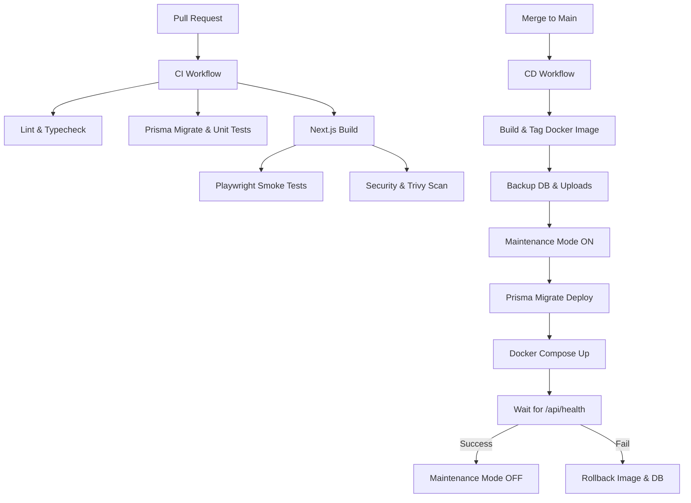

# CI/CD Pipeline & Infrastructure

## Pipeline Architecture

## GitHub Secrets and Variables
To set up the pipeline, configure these in **Settings > Secrets and variables > Actions**:

### Secrets
- `JWT_SECRET`: Used for signing sessions.
- `ENCRYPTION_KEY`: Used for DB encryption.
- `DATABASE_URL`: Production Postgres URL (e.g., `postgresql://...`).
- `GEMINI_API_KEY`: (Optional) If using Gemini fallback.

### Variables
- `APP_URL`: E.g., `https://lecturelens.siet.edu`.
- `AI_PRIMARY`: `ollama`
- `AI_FALLBACK`: `gemini`
- `OLLAMA_BASE_URL`: `http://ollama:11434` (inside Docker).

## Setting up the Self-Hosted Runner
On the SIET server (Ubuntu/Linux):
1. Create a dedicated user: `sudo adduser github-runner`
2. Download the runner package from GitHub > Settings > Actions > Runners > New self-hosted runner.
3. Extract and configure: `./config.sh --url https://github.com/ORG/REPO --token XXXXXX --name siet-server --labels siet-server`
4. Install as a service: `sudo ./svc.sh install github-runner && sudo ./svc.sh start`

## Installing Ollama (Host Machine vs Docker)
Ollama is included in `docker-compose.yml`. However, if you want to run it on the host to utilize GPUs easily without NVIDIA Container Toolkit:
1. Install host: `curl -fsSL https://ollama.com/install.sh | sh`
2. Update `.env`: `OLLAMA_BASE_URL=http://host.docker.internal:11434` (and uncomment the `host.docker.internal` host mapping in docker-compose).
3. The `ollama-init` service in docker-compose automatically pulls `qwen2.5:7b-instruct` and `nomic-embed-text`.

## Troubleshooting & Rollbacks
- **Logs**: Read failed deploy logs in the Actions tab.
- **Manual Rollback**: Go to Actions > Deploy > Run workflow, and input the previous safe Commit SHA.
- **Restore Backup**: Unzip `backups/uploads_XXX.tar.gz` to `public/uploads/` and replace `dev.db` with the SQLite backup (if using SQLite) or restore the Postgres dump.
- **AI Degradation**: If Ollama crashes, `/api/health` still reports 200 OK (App: UP, AI: DOWN). The system seamlessly falls back to Gemini if configured, or degrades gracefully.
